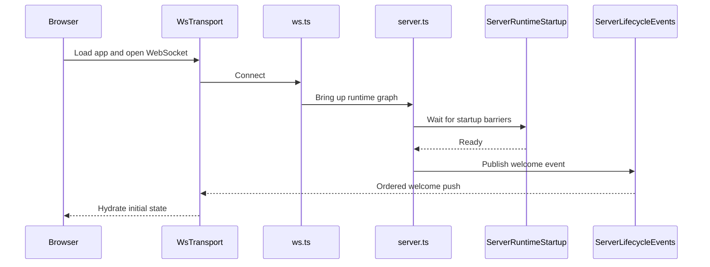
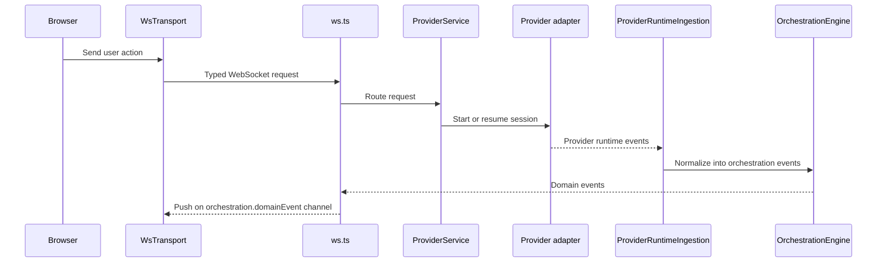
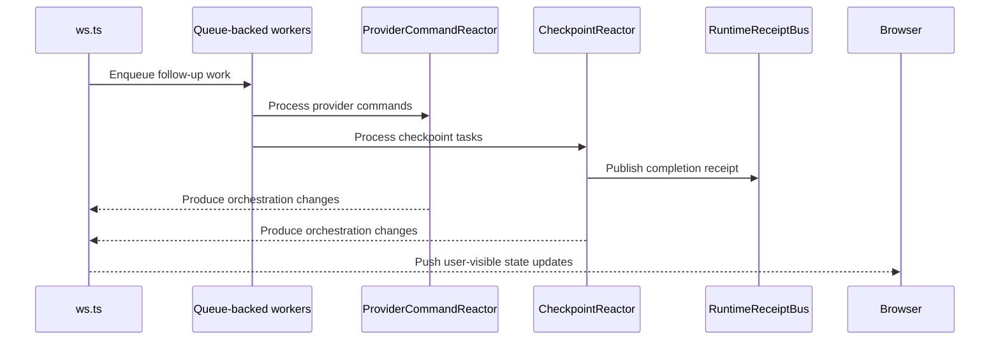

# Architecture

Pied Piper runs as a **Node.js WebSocket server** that hosts provider adapters (Claude as primary, Codex as a secondary adapter) and serves a React web app.

```
┌─────────────────────────────────┐
│  Browser (React + Vite)         │
│  wsTransport (state machine)    │
│  Typed push decode at boundary  │
└──────────┬──────────────────────┘
           │ ws://localhost:3773
┌──────────▼──────────────────────┐
│  apps/server (Node.js)          │
│  WebSocket + HTTP static server │
│  ServerLifecycleEvents          │
│  ServerRuntimeStartup           │
│  OrchestrationEngine            │
│  ProviderService                │
│  CheckpointReactor              │
│  RuntimeReceiptBus              │
└──────────┬──────────────────────┘
           │ provider adapters
┌──────────▼──────────────────────┐
│  ClaudeAdapter   CodexAdapter   │
│  (primary)       (secondary)    │
└─────────────────────────────────┘
```

## Components

- **Browser app**: The React app renders session state, owns the client-side WebSocket transport, and treats typed push events as the boundary between server runtime details and UI state.

- **Server**: `apps/server` is the main coordinator. It serves the web app, accepts WebSocket requests, waits for startup readiness through `ServerRuntimeStartup` before welcoming clients, and publishes ordered lifecycle events through `ServerLifecycleEvents`.

- **Provider runtime**: The actual coding-agent work runs behind a provider adapter. Claude is the primary adapter; Codex is also wired. Both expose the same Effect-typed contract through `ProviderService`, and their runtime events are translated into the app's orchestration model.

- **Background workers**: Long-running async flows such as runtime ingestion, command reaction, and checkpoint processing run as queue-backed workers. This keeps work ordered, reduces timing races, and gives tests a deterministic way to wait for the system to go idle.

- **Runtime signals**: The server emits lightweight typed receipts when important async milestones finish, such as checkpoint capture, diff finalization, or a turn becoming fully quiescent. Tests and orchestration code wait on these signals instead of polling internal state.

## Event Lifecycle

### Startup and client connect



1. The browser boots [`wsTransport`][1] and registers typed listeners in [`wsNativeApi`][2].
2. The server accepts the connection in [`ws.ts`][3] and the runtime graph is brought up in [`server.ts`][7].
3. [`ServerRuntimeStartup`][4] waits until the key startup barriers are complete.
4. Once the server is ready, [`ServerLifecycleEvents`][5] publishes a `welcome` event using the contracts in [`ws.ts`][6].
5. The browser receives that ordered push through [`wsTransport`][1], and [`wsNativeApi`][2] uses it to seed local client state.

### User turn flow



1. A user action in the browser becomes a typed request through [`wsTransport`][1] and the browser API layer in [`nativeApi`][12].
2. [`ws.ts`][3] decodes that request using the shared WebSocket contracts in [`ws.ts`][6] and routes it to the right service.
3. [`ProviderService`][8] starts or resumes a session and dispatches it to the provider adapter for that thread (Claude by default, or Codex if explicitly selected).
4. Provider-native events are pulled back into the server by [`ProviderRuntimeIngestion`][9], which converts them into orchestration events.
5. [`OrchestrationEngine`][10] persists those events, updates the read model, and exposes them as domain events.
6. [`ws.ts`][3] pushes those updates to the browser on channels defined in [`orchestration.ts`][11].

### Async completion flow



1. Some work continues after the initial request returns, especially in [`ProviderRuntimeIngestion`][9], [`ProviderCommandReactor`][13], and [`CheckpointReactor`][14].
2. These flows run as queue-backed workers using [`DrainableWorker`][16], which helps keep side effects ordered and test synchronization deterministic.
3. When a milestone completes, the server emits a typed receipt on [`RuntimeReceiptBus`][15], such as checkpoint completion or turn quiescence.
4. Tests and orchestration code wait on those receipts instead of polling git state, projections, or timers.
5. Reactors that subscribe to PubSub event streams must subscribe synchronously (via `PubSub.subscribe`) before any events can be published, then iterate with `PubSub.take` in a forked fiber. `Stream.fromPubSub` subscribes lazily and can miss events published in the dispatch gap.
6. Any user-visible state changes produced by that async work still flow back to the browser through [`ws.ts`][3].

[1]: ../apps/web/src/wsTransport.ts
[2]: ../apps/web/src/wsNativeApi.ts
[3]: ../apps/server/src/ws.ts
[4]: ../apps/server/src/serverRuntimeStartup.ts
[5]: ../apps/server/src/serverLifecycleEvents.ts
[6]: ../packages/contracts/src/ws.ts
[7]: ../apps/server/src/server.ts
[8]: ../apps/server/src/provider/Layers/ProviderService.ts
[9]: ../apps/server/src/orchestration/Layers/ProviderRuntimeIngestion.ts
[10]: ../apps/server/src/orchestration/Layers/OrchestrationEngine.ts
[11]: ../packages/contracts/src/orchestration.ts
[12]: ../apps/web/src/nativeApi.ts
[13]: ../apps/server/src/orchestration/Layers/ProviderCommandReactor.ts
[14]: ../apps/server/src/orchestration/Layers/CheckpointReactor.ts
[15]: ../apps/server/src/orchestration/Layers/RuntimeReceiptBus.ts
[16]: ../packages/shared/src/DrainableWorker.ts
