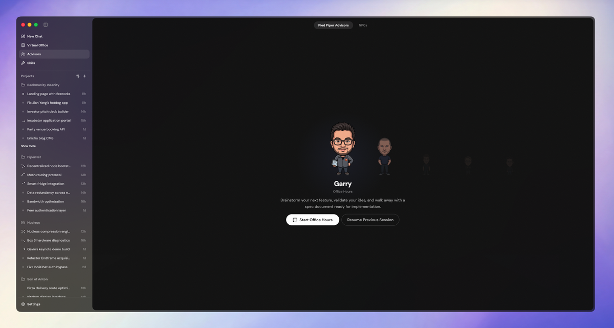

# Pied Piper

Personal fork of [t3code](https://github.com/pingdotgg/t3code). If you want something stable and maintained, use that instead.

Things might disappear or break. Nothing here is stable or supported.

I'm not a developer. Every line of code in this fork (anything not from the original t3code repo) was AI generated. I just pointed and directed. If this thing deletes your code, that's between you and the robots.

## Why fork it

I needed a nice way to run multiple Claude instances. Most of the other apps were either too buggy or too complex for what I wanted. t3code was fast, stable, and easy to extend. Being open source meant I could add or change whatever I needed. Huge thanks to Theo and Julius for building such a solid base.

## What I added

**Office mode** is a visual overview where you can see all your agents, who's working, who's done, and what's happening across threads. Makes the whole thing feel less like a chat app and more like a war room. I like chatting with Jian Yang while I wait for my agents to finish. Future iterations will build on this so I can do everything from this view. Makes coding feel more like a game.


**Pied Piper Advisors** is a fork of [gstack](https://github.com/garrytan/gstack) by Garry Tan, simplified down to 5 agents. Big thanks to Garry for putting gstack out there. This fork doesn't include a lot of the power features of the original so you should use the official skill to get the full benefit. This is just what I plan to use for myself so I forked it and am making small tweaks to fit my workflows. The advisors UI is simple and fun. Pick an advisor, start a skill, or just chat with them inline.



**Skills** is a simple way to see what I have installed and get new ones. Least developed area, more work to follow.

## How to run

I just ask Claude to run it and it works. I recommend you do the same. Here's what Claude says you should do:

> ### Prerequisites
>
> - [Bun](https://bun.sh)
> - [Claude Code](https://docs.anthropic.com/en/docs/claude-code) (run `claude auth login` first)
> - [Codex](https://github.com/openai/codex) is optional if you want to use it as a provider
>
> ### Web (dev mode)
>
> ```bash
> bun install
> bun scripts/dev-runner.ts dev
> ```
>
> Opens at `http://localhost:5733`. Server on port `3773`.
>
> ### Desktop (Electron)
>
> ```bash
> bun scripts/dev-runner.ts dev:desktop
> ```
>
> ### Build a .dmg
>
> ```bash
> bun run build
> bun run dist:desktop:dmg
> ```
>
> Output goes to `./release`. Unsigned by default. Right-click > Open on first launch.
>
> ### Production (no hot reload)
>
> ```bash
> bun run build
> bun run start
> ```

