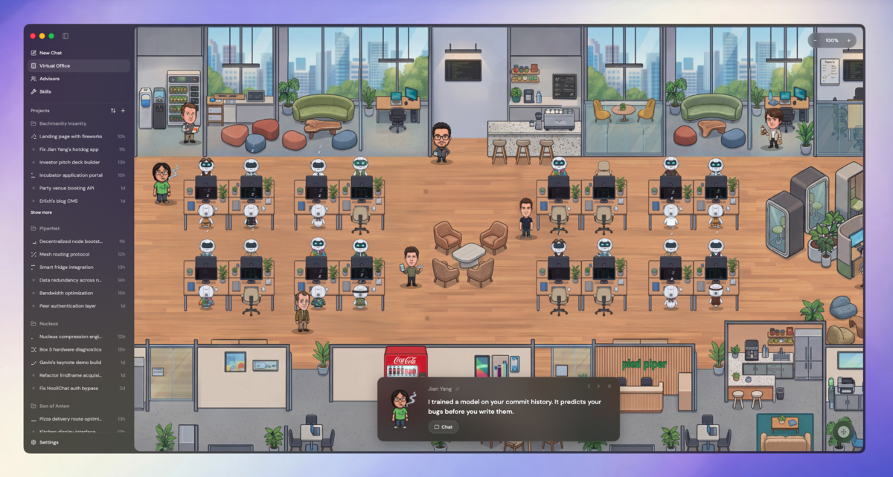

# Pied Piper

Things might disappear or break. Nothing here is stable or supported.

I'm not a developer. Every line of code I added was AI generated. I just pointed and directed. If this thing deletes your code, that's between you and the robots.

## Why I built it

I needed a nice way to run multiple Claude instances. Most of the other apps were either too buggy or too complex for what I wanted, so I built something fast, stable, and easy to extend.

## What I added

**Office mode** is a visual overview where you can see all your agents, who's working, who's done, and what's happening across threads. Makes the whole thing feel less like a chat app and more like a war room. Future iterations will build on this so I can do everything from this view. Makes coding feel more like a game.



## How to run

I just ask Claude to run it and it works. I recommend you do the same. Here's what Claude says you should do:

> ### Prerequisites
>
> - [Bun](https://bun.sh)
> - [Claude Code](https://docs.anthropic.com/en/docs/claude-code) (run `claude auth login` first)
> - [Codex](https://github.com/openai/codex) is optional if you want to use it as a provider
>
> ### Web (dev mode)
>
> ```bash
> bun install
> bun scripts/dev-runner.ts dev
> ```
>
> Opens at `http://localhost:5733`. Server on port `3773`. In a linked git worktree the ports differ; the `[dev-runner]` line shows the actual ones.
>
> ### Desktop (Electron)
>
> ```bash
> bun scripts/dev-runner.ts dev:desktop
> ```
>
> ### Build a .dmg
>
> ```bash
> bun run build
> bun run dist:desktop:dmg
> ```
>
> Output goes to `./release`. Unsigned by default. Right-click > Open on first launch.
>
> Linux AppImage builds (`bun run dist:desktop:linux`) need ImageMagick, so that `magick` or `convert` is available, to generate the standard icon sizes.
>
> ### Production (no hot reload)
>
> ```bash
> bun run build
> bun run start
> ```
